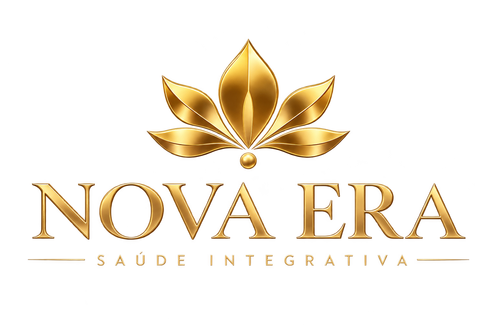

# 🎨 Guia Visual de Ajustes - Landing Page Nova Era

## 📸 Imagens - Antes e Depois

### 1️⃣ Hero (Topo da Página)

#### ❌ ANTES
```
- Imagem de capa com object-cover
- Cortava laterais da logo
- Sem controle sobre proporção
```

#### ✅ AGORA
```jsx
<div className="... bg-[#191614] flex items-center justify-center p-8">
  
</div>
```

**Resultado:**
- Fundo escuro elegante (#191614)
- Logo centralizada e sem cortes
- `object-contain` preserva proporções
- Padding de 8 unidades para respiração visual

---

### 2️⃣ Card "O Diferencial Nova Era"

#### ❌ ANTES
```
- Imagem repetida/genérica
- Altura fixa min-h-[400px]
- Sem proporção específica
```

#### ✅ AGORA
```jsx
<div className="... aspect-[4/5] lg:aspect-auto lg:min-h-[500px]">
  
</div>
```

**Resultado:**
- Foto editorial "Conhecendo sua história"
- Proporção 4:5 no mobile (retrato elegante)
- Auto-ajuste no desktop com altura mínima de 500px
- `object-cover` preenche todo o espaço

---

## 🔘 Botão Flutuante WhatsApp

### ❌ ANTES
```jsx
<a className="... shadow-2xl ...">
  <MessageCircle />
  {/* Pulso animado */}
  <span className="... animate-ping ..." />
</a>
```

**Problemas:**
- Pulso animado chamava muita atenção
- Sombra exagerada (shadow-2xl)
- Visual menos profissional

### ✅ AGORA
```jsx
<a className="fixed bottom-6 right-6 z-50 ... shadow-lg ...">
  <MessageCircle className="w-7 h-7 sm:w-8 sm:h-8" />
</a>
```

**Resultado:**
- Fixo no canto inferior direito absoluto
- Sombra suave (shadow-lg)
- Sem animação de pulso
- Hover suave com scale-110
- Visual mais discreto e elegante

---

## 🎨 Paleta de Cores Mantida

```css
Areia Quente (Fundo):    #F9F7F3
Bege Suave (Cards):      #EFECE6
Marrom Carvão (Texto):   #1E1B18
Dourado Fosco (Detalhes): #B8924A
Borda Sutil:             #E5DFD5
Fundo Logo Hero:         #191614 (novo)
```

---

## 📐 Proporções e Responsividade

### Hero - Logo
```
Mobile:  h-64 (256px)
Tablet:  h-80 (320px)
Desktop: h-[400px]
```

### Diferencial - Imagem Editorial
```
Mobile:  aspect-[4/5] (retrato)
Desktop: aspect-auto + min-h-[500px]
```

### Botão WhatsApp
```
Mobile:  w-14 h-14 (56px)
Desktop: w-16 h-16 (64px)
Posição: fixed bottom-6 right-6 z-50
```

---

## 🚀 Performance

### Otimizações Aplicadas
✅ `object-contain` na logo (não força redimensionamento)
✅ `object-cover` na foto editorial (preenche sem distorcer)
✅ WebP usado quando possível (`card 2.webp`)
✅ Aspect ratio CSS para evitar layout shift
✅ Z-index correto (z-50) para botão flutuante

### Tamanhos de Arquivo
```
Logo.png:      ~1.47 MB (poderia otimizar)
card 2.webp:   (formato WebP já é otimizado)
```

**💡 Dica:** Considere comprimir `Logo.png` para WebP se necessário.

---

## ✅ Checklist de Validação

- [x] Logo centralizada sem cortes no hero
- [x] Fundo escuro elegante (#191614) na logo
- [x] Foto "Conhecendo sua história" no card de diferencial
- [x] Proporção 4:5 no mobile para foto editorial
- [x] Botão WhatsApp fixo no canto inferior direito
- [x] Sombra suave (shadow-lg) no botão
- [x] Sem pulso animado no botão
- [x] Fundo geral em Areia Quente (#F9F7F3)
- [x] Ícones dourados (#B8924A) bem contrastados
- [x] Build de produção sem erros
- [x] Hot reload funcionando no dev

---

## 🎯 Foco em Conversão Mantido

Todos os CTAs levam para WhatsApp:
1. Botão header (fixo no topo)
2. CTA hero (banner principal)
3. 4 cards de atalho rápido (com mensagens pré-definidas)
4. Links no footer
5. Botão flutuante (sempre visível)

**Resultado:** Máxima conversão sem poluir a experiência visual.

---

**Página enxuta, rápida e focada!** 🚀
